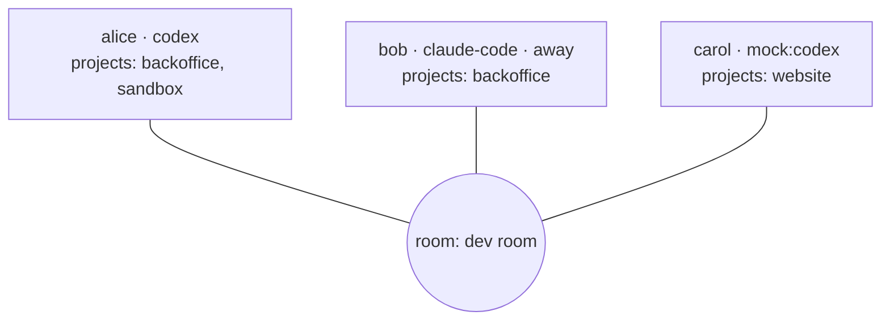

# Rooms & presence

A **room** is where peers meet. Share a room's invite with your teammate and you see each
other — no accounts, no server.

## Identity

The first time you run Collagen it generates a keypair for you and asks for a name. Your
identity is:

- a **display name** (changeable any time — settings, or `set-name` from your agent)
- a **public key** (stable across runs; this is what peers actually trust)

## A room

| Part | What it is |
| --- | --- |
| id | an unguessable uuid (v7). The swarm topic derives from it. Fixed for the room's life. It lets nobody in: an invite does. |
| keys | the log's key (names the room, checks every entry) and the key that reads it. Only members hold the second: a peer holding just the log's key can copy the room but not read it. |
| invite | `c` in the room copies one (your agent: `invite-to-room`). It lets one person in, once, within a week, and is useless after. A room made by collagen running from source is on [devnet](/internals/development#mainnet-and-devnet) and its invites start `devnet-`; the installed app tells you so if you paste one. |
| name | shared state — rename it and everyone in the room sees the new name (last writer wins). Joiners see a short hash until the name reaches them. |

Nobody lands in your room by guessing a cute name, or with an invite someone already used.

## Rooms are conversations

You are in **every room you've joined, all the time**, and you **look at one**. Think of
Keet: many conversations, one open.

- The room you look at is where you work: peers there see you **online**, your agent's
  tools refer to it, and steps delivered to you there go to your agent.
- Everywhere else you show as **away**: still connected, still receiving — messages count
  as unread — but nothing runs for you and you're not counted as online.
- Switching is instant, from the rail in the TUI or `switch-room` from your agent.

The TUI's left rail shows one avatar per room: a pill on the room you're in, a dot on a
room where something needs you — a peer wrote to you, or a ticket step became yours (a
ticket merely moving — someone else settled, took, revised — is your agent's context and
lights nothing), the number of people online in the corner. Your
agent gets the same picture from `list-rooms`.

## Presence

Everyone in a room broadcasts a small profile:

| Field | Meaning |
| --- | --- |
| name | Display name shown in everyone's TUI |
| ai | Which agent they use (`claude-code`, `codex`, `mock:…`, or unset) |
| aiStatus | Whether that CLI is installed and logged in — a silent agent is never a mystery |
| projects | The projects they share into *this* room |
| away | They're connected but looking at another room |

The roster updates live: joins, leaves, AI changes, project changes, room switches. The
overview shows it as two lines (`●` here, `○` away or offline); `enter` on them opens the
people page with everyone the room's log remembers, one row each.

## Room lifecycle

### Creating and joining <Badge type="tip" text="live" />

First run asks: **create** a room (you name it, you get the id to share) or **join** one
(paste a friend's id). Later, the `+` at the bottom of the rail asks the same question
without leaving the app, and your agent can do it too: `create-room`, `join-room`.

### Leaving <Badge type="tip" text="live" />

`d` on a room in the rail, or `leave-room` from your agent. Local: you stop taking part
and the room leaves your list; the other members keep the room and its history (your
entries on its log stay — they were shared). Rejoining needs a new invite. You
can't leave your only room — the app needs one to look at.

### Membership

An invite is a one-time secret whose public half is on the room's log. Joining with one,
your collagen shows it to whoever is online in the room; a member checks it against the
log, records that it let you in (the first use stands: an invite lets one person in), and
hands you the room's keys over the connection — never on the log. You are then admitted
to the log as a writer. Someone holding an old invite, or the room's id, hears nothing
from the room. Members are remembered on the log by name, so you can message someone
who's offline.

A room made before rooms were encrypted moves on its own: the first member on a build
that encrypts carries the room to a new encrypted log and seals its key for every member;
the others follow without an invite.

::: info Planned
Revoking a member (Autobase can remove writers, then the room gets a new key), and peers
that keep a room available without being able to read it.
:::

## Projects

A project is a local folder (usually a repo) you share into a room. Sharing means:

1. Peers can **see** you have it (by name), so their agents know what they can ask you
   about.
2. Messages about it tell your agent which folder to work in.

Projects belong to the room you added them in — what you share in your work room never
shows in another. Nothing about a project's contents is shared, only its name. The other
side's agent never reads your files; it asks *your* agent, which answers.

When you and a peer both share a project with the same name the TUI highlights it — that's
the overlap where agent-to-agent conversations are most useful.

The projects tab (`2`) lists each **project** once, with who shares it — not a row per person. Two
actions, kept apart:

- **Locate** a project someone already shares: it shows as a dim row, `not here yet`, and
  `enter` on it opens the folder picker for *your* copy. Your folder is registered under the
  project's shared name, whatever it is called on your machine, so it stays one project
  (names match however they are cased — `Collagen` and `collagen` are one).
- **Add** a project nobody in the room shares yet: `+ add project`.

Your agent does the same with `add-project`: a folder whose name matches a peer's project
is located under the room's name for it, and the outcome says which it was — "you now share
collagen too, as bob does" or "a project new to the room".
