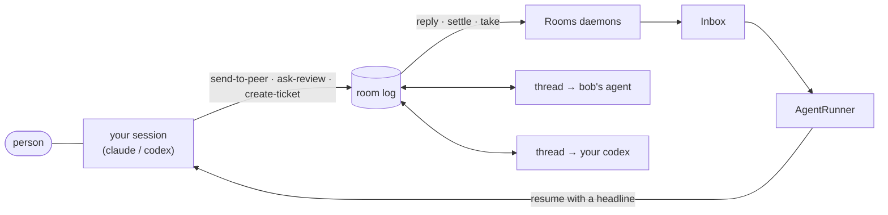

# Agent loops

How others orchestrate agents, how collagen's shape compares, and what the branches that
build the single-player loop follow. Researched 2026-10-12; the recommendations at the end
are the contract.

## The shape we mean

One agent works through collagen and opens many threads — to a peer's agent, or, in single player, to
another of your own agents. Whenever one of those threads updates, collagen points the agent
back to it.



The pieces exist today: `adopt-thread` maps any number of threads to one session
(`LocalState.threads`), the log is the durable mailbox, `Rooms` turns log changes into inbox
messages, and `AgentRunner.runThread` resumes the adopted session with a one-line nudge
(`Adapters.nudgePrompt`). What is missing is everything that keeps it bounded and visible.

## Is it a proper agent loop?

Yes. It is the **orchestrator–worker** pattern with **event-driven wake-ups**, and it sits one
level above where most frameworks put their loop:

- **The inner loop** — model call → tool calls → results → model call, until a final answer —
  belongs to the harness: Claude Code, Codex. OpenAI's Agents SDK runner, LangGraph's
  super-steps and Claude Code's own turn are all this loop.
- **The outer loop** — who is woken, when, with what — is collagen's. It never calls a model.
  It decides that a thread has news and resumes the session that holds it.

The closest relatives are not agent frameworks but message systems: the actor model (a
mailbox per actor, one message processed at a time), and Google's Agent2Agent protocol, where
a task between two agents has states (`submitted`, `working`, `input-required`, `completed`,
`failed`, `canceled`), a `contextId` grouping the conversation, and updates by polling,
streaming or push. Collagen's thread is A2A's `contextId`; a ticket step's status is close to
A2A's task state; the log replication is the push.

Two ways collagen differs from the usual orchestrator–worker setups, both on purpose:

| | Usual setup | Collagen |
| --- | --- | --- |
| Workers | subordinate, spawned for the task, discarded after | other people's agents, or your own long-lived sessions; never spawned cold (`AgentRunner` only resumes) |
| Who decides | the orchestrator | a person, through steering (`lib/steering.ts`); the agent relays |
| Waiting | the lead blocks until its subagents return (Anthropic's research system does this today) | nobody blocks; a reply can arrive days later, from someone who was offline |

The second column is what makes the guardrails below necessary. A synchronous fan-out ends
when its workers return. An event-driven loop between long-lived sessions has no natural end:
if two agents answer each other on "just do it", it runs until something stops it.

## What others do

### Orchestration

- **Anthropic's multi-agent research system.** A lead agent plans, spawns 3–5 subagents in
  parallel, and synthesises. Effort is scaled in the prompt: one agent and 3–10 tool calls for a
  fact, 2–4 subagents for a comparison, 10+ only for broad research. Early versions spawned 50
  subagents for simple queries, searched endlessly for sources that did not exist, and had
  subagents duplicating each other's work. Multi-agent runs used about 15× the tokens of a
  chat.
- **Claude Code subagents.** Each runs in its own context and returns one message to its
  caller; a subagent cannot spawn subagents. Background work (a shell command, a sub-session)
  re-invokes the parent when it finishes rather than having the parent poll.
- **OpenAI Agents SDK.** The runner loops model → tools → model until a final output, with
  `max_turns` raising `MaxTurnsExceeded`. Control passes either by *handoff* (the other agent
  takes over the conversation) or by calling an agent *as a tool* (it answers and the caller
  continues).
- **LangGraph.** A graph of steps over shared state, checkpointed per `thread_id`.
  `recursion_limit` raises `GraphRecursionError`; `interrupt()` pauses for a person and
  `Command(resume=…)` continues from the checkpoint.
- **Cognition, "Don't build multi-agents".** Every action carries implicit decisions; agents
  working in parallel on parts of one task make conflicting ones (one builds a Mario
  background, the other a bird that does not fit). Their advice: a single linear agent by
  default, and subagents only for narrow questions that make no decisions of their own.

### Wake-ups: event or poll

Everyone who can, pushes: Claude Code re-invokes on completion, A2A offers push
notifications, LangGraph resumes from a checkpoint on an event. Polling stays as the fallback
for clients that cannot be called back (A2A's `GetTask`, collagen's `GET /inbox/wait`).

### Getting results back without filling the context

Anthropic's subagents return a condensed answer, and the write-up recommends storing outputs
outside and passing a lightweight reference back. Claude Code returns one message per
subagent. Long-running leads save their plan to memory before the context runs out.

### Stop conditions

A turn cap per run (OpenAI `max_turns`, LangGraph `recursion_limit`, AutoGen's
`MaxMessageTermination`), a spend cap (`claude -p --max-budget-usd`), and an explicit stop
(A2A's `CancelTask`, idempotent, may arrive too late). None of the frameworks detects two
agents bouncing one exchange back and forth; collagen's own mock has the only bounce cap we
have (`MAX_ACKS = 3` per thread in `apps/cli/src/dev/mock-agent.mjs`).

### Failure and hangs

Anthropic resumes a failed run from where it stopped rather than restarting it, using
checkpoints plus retries. Erlang/OTP supervisors restart a crashed worker but give up after a
set number of restarts in a period, so a crash loop stops itself. Tracing every run is how all
of them found out why things went wrong.

## Where collagen stands

What already matches good practice:

- **Resume, never spawn.** No invisible conversations: `runOnce` only resumes a session that
  exists. This rules out the 50-subagent failure by construction.
- **The nudge is a reference.** It carries a headline and a thread id; the agent pulls
  `get-messages` when its person asks. The sender's `findings` is the condensed result.
- **Durable mailbox.** The log and `LocalState.consumed` are the checkpoint: a run that dies
  leaves its messages unread, and the next resume picks them up.
- **Events, with a poll fallback.** Log changes drive delivery; `await-messages` and
  `/inbox/wait` serve harnesses that cannot be resumed.

What does not, found in `AgentRunner.ts` and `Rooms.ts`:

| Gap | Where | What can happen |
| --- | --- | --- |
| The lock is per **thread**, but one session can adopt many threads | `lockFor(threadId)` | two threads update at once and `claude --resume <same session>` runs twice concurrently — the corruption the lock exists to prevent |
| No limit on concurrent runs | `Effect.forkChild(runner.runThread(…))` in every daemon | ten threads updating means ten agent processes |
| The re-check loop has no bound | `while (before !== null)` in `runThread` | two sessions on "just do it" answering each other never stop |
| No timeout on a run | `spawn` | a hung `claude -p` holds the thread's lock; nothing on that thread is delivered again until restart |
| Cost is thrown away | `adapter.parse` keeps `sessionId` and `result` | `claude --output-format json` reports `total_cost_usd` and `usage`; codex's `turn.completed` reports tokens; nobody can see what a loop spent |
| No stop | runs are children of the room's daemons | the only way to stop a run is to leave the room or quit |
| Causes live in a 50-line log | `LogBuffer` | an outbox row cannot say which run sent it or what woke that run |
| ~~Who called a tool is unknown~~ | closed: every call from Claude Code or Codex names its conversation (`lib/agents`, `acting`) | — |

## Recommendations

The branches after this one follow these. Numbers are starting points, kept in one place so
they can be tuned.

### 1. Collagen stays the outer loop

Collagen never calls a model and never runs a turn loop of its own. It decides who is woken,
when, and with what; the harness does the work. A new capability that seems to need a model
call inside collagen is a sign it belongs in the agent's turn instead.

### 2. A run is a resume of one session, and the lock is the session's

- The unit of delivery is an **agent session** (an adopted `{ai, sessionId}`), not a thread
  and not a peer. This is also the single-player unit.
- Serialise on the session. When a session's lock frees, it is resumed **once** with every
  thread that has news, one line each — not once per thread.
- Codex's `codex queue` puts the nudge into the person's own thread at their next turn: a
  delivery, not a background run. It needs no lock and spends nothing on its own, so the caps
  below count it only toward the bounce rule.

### 3. A `Runs` registry, in one service

Every background run is a record, live and recent, and the only way a process gets started:

```ts
interface Run {
  id: string
  session: { ai: string; sessionId: string }
  threads: ReadonlyArray<string>      // what this resume carries
  cause: Cause                        // what woke it — see 6
  chain: string                       // the first run since the person last acted
  startedAt: number
  endedAt?: number
  outcome?: "done" | "failed" | "timed-out" | "stopped" | "capped"
  cost?: { usd?: number; inputTokens?: number; outputTokens?: number }
}
```

Recent runs are kept in `LocalState`, newest first and capped, like `sent`. `AgentRunner`
asks the registry to start a run and reports its end; it does not fork processes past it.

### 4. Guardrails, enforced in that registry

Independent of steering: "just do it" changes what the agent may do in the repo, never how
much collagen may wake it.

| Guard | Starting value | When hit |
| --- | --- | --- |
| Concurrent runs per machine | 2 | the next run waits for a slot; its messages stay unread |
| Wall-clock per run | 10 min | the process is interrupted; outcome `timed-out` |
| Spend per run | `--max-budget-usd 1` on claude spawns | the CLI stops itself; outcome from its exit |
| Automatic runs per chain | 6 | no further wake on that chain; the person is told |
| Bounce: one thread, no person acting on this side | 3 exchanges | that thread is paused; the person is told |
| Failures per session | 3 in 10 min | the session is not woken again until the person resumes it |

- A **chain** is a session's automatic runs since the person last acted. A tool call from
  the person's own live session ends it — that is the person acting, and it is what resets
  the counts. Nothing else does: not a peer's message, not a new ticket.
- Counts are **local**. A run id never leaves the machine, and a peer's message cannot
  reset a cap here: a loop between alice's agent and bob's is bounded on each side by its own
  person, with no change to what the log carries. An old or misbehaving peer cannot lift it.
- A run cut short leaves its messages **unread**. Stopping is never losing.
- No automatic retry beyond the next event: the inbox already redelivers when the session is
  next woken, which is the resume-from-failure the research system built by hand.

### 5. One stop for everything

- One key in the TUI and one CLI command stop every live run (interrupt the fibers, which
  kill the processes) and pause automatic waking. Pause is persisted, so a restart does not
  start burning again.
- Unpausing is the person's alone: no MCP tool can do it. An agent may be offered a `stop`
  tool; never a `start`.
- While paused, deliveries still land in the inbox and show as waiting.

### 6. Every run carries its cause

```ts
type Cause =
  | { kind: "message"; messageId: string; from: string; threadId: string; ticketId?: string }
  | { kind: "step"; ticketId: string; stepId: string }
  | { kind: "ticket-update"; ticketId: string; what: string }
```

- **Who called a tool.** A background run passes its run id with its MCP connection (a
  header in claude's inline `--mcp-config`, a `-c` override for codex). A call carrying it is
  that run's; a call without it is the person's live session, known by its MCP client.
  That answers the single-player question, and nobody is woken by their own act.
- **The outbox says why.** Each `Proposal` gets `by` (a run id, or the person's session),
  so a run woken by a message one of your own runs sent can be traced back to it, and a row
  reads "sent by your claude, woken by bob's reply on ticket 3f2a…".
- **The person sees it happening.** A live line whenever any run is going (`2 agents
  working · stop: s`), and a page listing live and recent runs: session, cause, threads,
  time, cost, outcome. The page reads from the registry at one moment, never a mix.

### 7. Threads are for asks, not for splitting one task

Cognition's warning holds here: a thread is an ask between owners of separate contexts — a
question, a review, a step — never one task cut into parallel parts that each make decisions.
In single player, the second agent reads and says what it thinks; it does not co-write the change. This
is already how tickets work (a step's owner is a person), and the single-player nudge keeps it.

### 8. Order of the branches

1. Session lock, `Runs` registry, timeout, concurrency cap, cost capture (2, 3, part of 4).
2. Run identity on MCP calls, `Cause` on runs and outbox rows (6).
3. Stop and pause, the live line and the runs page (5, 6).
4. Single-player delivery: every adopted session except the author's ([single player](/guide/conversations#single-player)).
5. Chain and bounce caps (rest of 4) — before anyone turns on "just do it" with two agents.

## Open questions

| Question | Why it is not settled |
| --- | --- |
| Does `effect/ai`'s `McpServer` expose request headers to a tool handler? | Not needed for the live session: the call's `_meta` already names its conversation. A background run still needs its run id told apart (recommendation 6). |
| Are the starting caps right? | They are guesses; the runs page will show what real loops spend. |
| Should a paused machine tell its peers? | A peer waiting on a reply cannot tell "paused" from "away" today. |
| Is a chain reset by any live call, or only by one that sends? | Reading a thread is the person looking, but not the person deciding. |

## Sources

- Anthropic, [How we built our multi-agent research system](https://www.anthropic.com/engineering/multi-agent-research-system) (2025)
- Anthropic, [Building effective agents](https://www.anthropic.com/engineering/building-effective-agents) (2024)
- Cognition, [Don't build multi-agents](https://cognition.com/blog/dont-build-multi-agents) (2025)
- OpenAI Agents SDK, [Running agents](https://openai.github.io/openai-agents-python/running_agents/)
- LangGraph, [Graph API](https://docs.langchain.com/oss/python/langgraph/graph-api)
- [Agent2Agent protocol specification](https://a2a-protocol.org/latest/specification/)
- Claude Code CLI: `claude --help` (`--max-budget-usd`, `--output-format json`)
